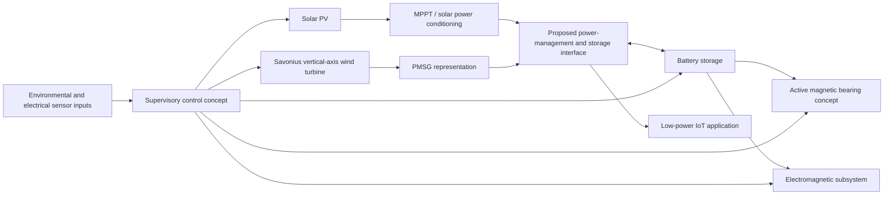

# System Architecture (Conceptual)

This diagram summarises the proposed hybrid-system concept described in the MSc dissertation. It is an architectural interpretation of the dissertation narrative, not proof that every connection was implemented or validated in the Simulink model.

## Main subsystems described in the dissertation

- **Solar path:** the dissertation describes a 12 V, 56 W solar panel, MPPT control and storage of generated energy in a battery.
- **Wind path:** the proposed subsystem uses a Savonius-type vertical-axis rotor. The concept includes permanent magnets mounted near the blade base and four electromagnets intended to interact with them. A PMSG is represented in the system model.
- **Bearing concept:** an active magnetic bearing is proposed in place of a conventional mechanical bearing. The dissertation estimates power requirements for the electromagnets used in its AMB discussion.
- **Storage and auxiliary supply:** the battery is intended to store solar-generated energy and provide power to the auxiliary electromagnetic and bearing subsystems.
- **Supervisory control:** the MATLAB `hybridControl` listing represents threshold-based logic using temperature, wind velocity, current, voltage and light-intensity inputs. Its action functions are placeholders; they are not Raspberry Pi hardware drivers.

## Interpretation and boundaries

The diagram is conceptual and is assembled from the dissertation's written description and MATLAB listings. It should not be described as a fully validated electrical single-line diagram, detailed control architecture or experimentally demonstrated energy-flow implementation.

The repository does not include the full Simulink project, complete converter topology, protection design, grounding arrangement, detailed sensor interfaces, control-loop dynamics or hardware implementation. The direction and magnitude of energy flows, including the auxiliary power consumed by the AMB/electromagnetic subsystems, require a complete system-level energy balance.

The dissertation's reported hybrid-model output also contains an operating-range inconsistency, documented in [Future Work and Technical Considerations](Future_Work_and_Technical_Considerations.md).
