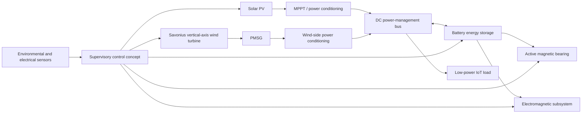

# System Architecture (Conceptual)

This diagram summarises the proposed hybrid-system concept described in the MSc dissertation. It is an architectural interpretation of the written description, **not proof that every connection was implemented or validated in the Simulink model**.

## Reading the diagram

- **Solar path:** the dissertation describes solar generation with MPPT control and storage of generated energy in a battery.
- **Wind path:** the proposed wind subsystem uses a Savonius-type vertical-axis rotor, permanent magnets/electromagnets, and an intended PMSG generation stage.
- **Storage and loads:** the battery is intended to support the low-power application and energise the bearing/electromagnetic subsystems when required.
- **Supervisory control:** the MATLAB `hybridControl` listing represents threshold-based control logic. Its action functions are placeholders; they are not Raspberry Pi hardware drivers.

## Scope note

The diagram is a conceptual representation assembled from the dissertation narrative and code listings. It should not be described as a fully validated electrical single-line diagram, detailed control architecture, or experimentally demonstrated energy-flow implementation. In particular, converter topology, rectification, protection, grounding, sensor interfaces, and control-loop dynamics would need to be specified in a further engineering design.
