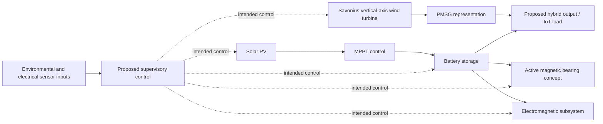

# Proposed System Architecture

This document summarises the proposed hybrid-system concept described in the MSc dissertation. It is a conceptual interpretation of the written description and model listings, not proof that every connection was implemented or validated in Simulink.

Dashed control links indicate the intended supervisory role described in the dissertation; they do not establish implemented hardware interfaces.

## Main subsystems described in the dissertation

- **Solar path:** The dissertation specifies a 12 V, 56 W solar panel and describes MPPT control and battery storage. It calculates a solar-energy estimate of 38.71 Wh using its stated assumptions.
- **Wind path:** The proposed subsystem uses a Savonius-type vertical-axis rotor. The design description includes four permanent magnets near the blade base and four electromagnets intended to interact with them.
- **Bearing concept:** An active magnetic bearing is proposed in place of a conventional mechanical bearing. Chapter 3 estimates 2.25 W per electromagnet and 9 W for four electromagnets using the dissertation's stated calculation.
- **Generator:** A PMSG is represented by a simplified MATLAB function based on angular velocity and fixed parameters.
- **Storage and auxiliary supply:** The battery is intended to store solar-generated energy and supply the auxiliary electromagnetic and bearing subsystems.
- **Supervisory control:** The MATLAB `hybridControl` listing accepts temperature, wind velocity, current, voltage and light-intensity inputs. Its action routines are placeholders. The dissertation identifies further control-system simulation, Raspberry Pi integration and hardware setup as future work.

## Interpretation and boundaries

The diagram is conceptual and is assembled from the dissertation's written description and MATLAB listings. It is not a validated electrical single-line diagram, detailed control architecture or experimentally demonstrated energy-flow implementation.

The repository does not include the complete Simulink project, converter topology, protection design, detailed sensor interfaces, control-loop dynamics or hardware implementation. The net energy balance must account for auxiliary power consumed by the AMB and electromagnetic subsystems.

The dissertation's reported hybrid-model output and its Chapter 6 interpretation of the optimal wind-speed range are inconsistent. See [Future Work and Technical Considerations](Future_Work_and_Technical_Considerations.md).
